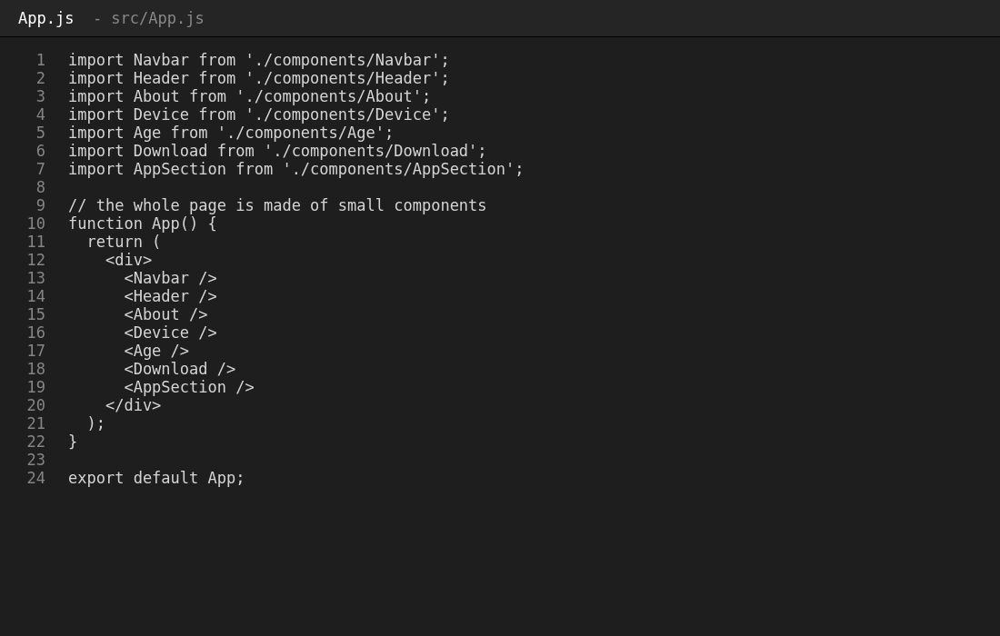
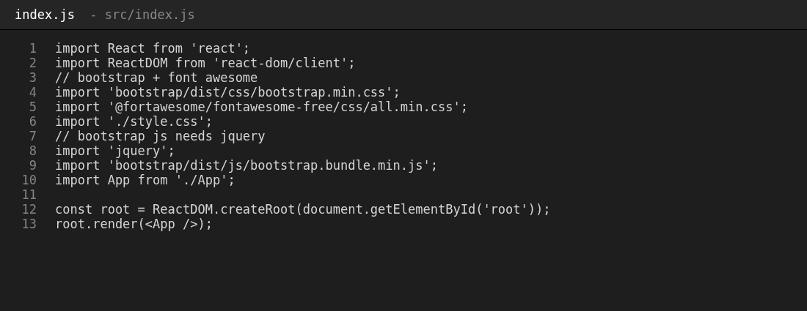
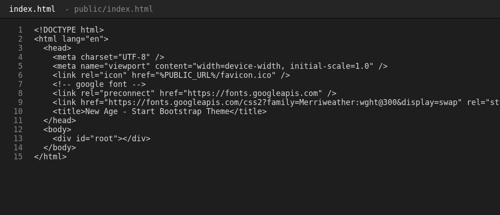
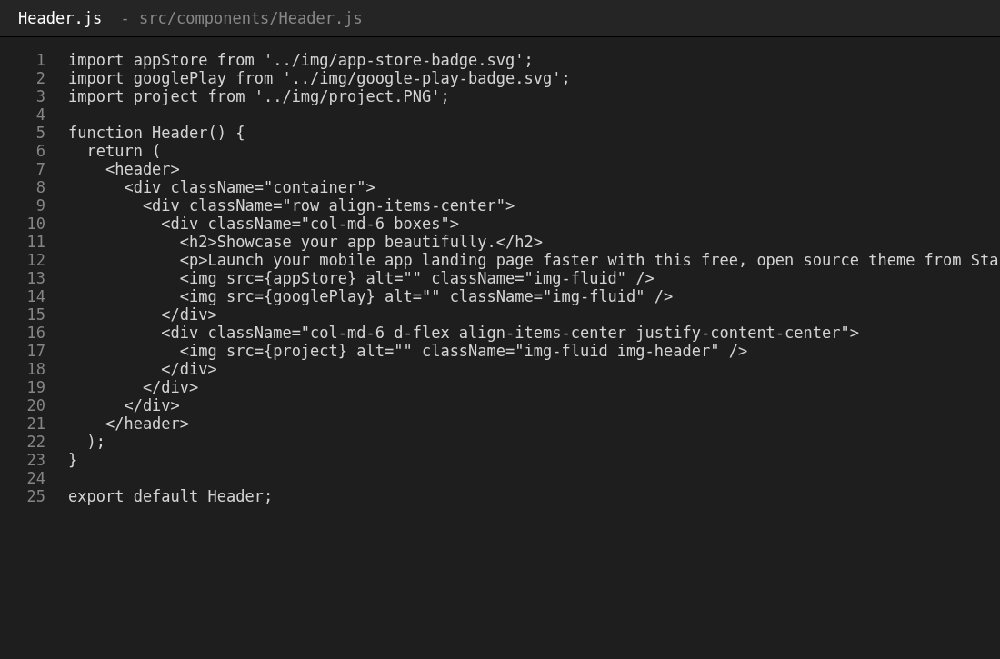
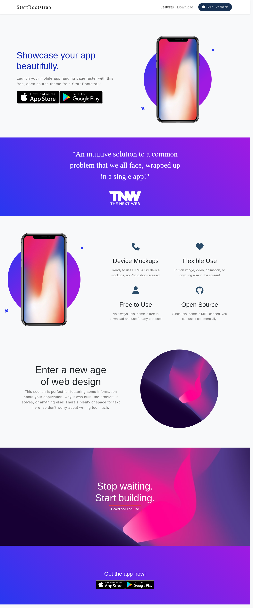

# React Task 2 - New Age landing page

I converted the HTML landing page (New Age - Start Bootstrap theme) to React.

Live demo: https://depi-react-tasks.github.io/react-task-2/

## What I did
1. Created a React project with create-react-app
2. Deleted the files I don't need
3. Split the page into components: Navbar, Header, About, Device, Age, Download, AppSection
4. Changed `class` to `className`, closed the `img` and `br` tags, and used `{/* */}` for comments
5. Moved the images and `style.css` into `src` and imported them
6. Installed bootstrap, jquery and font awesome with npm (the navbar and the modal need the bootstrap js)

## App.js

## index.js

## index.html

## Header component

## Result

## Note
The `docs` folder is the production build (`npm run build`), it is used for GitHub Pages.
The Unsplash links in the original files don't work anymore, so I used the photo from the assets folder.

## Task 3: props and map
I added a new section at the bottom of the page. It shows 5 people, and the data comes from an array of objects.
- `People.js` has the array of objects and uses `map` to make a component for every object.
- `Person.js` is the component that takes the data with `props` (name, color, id).

